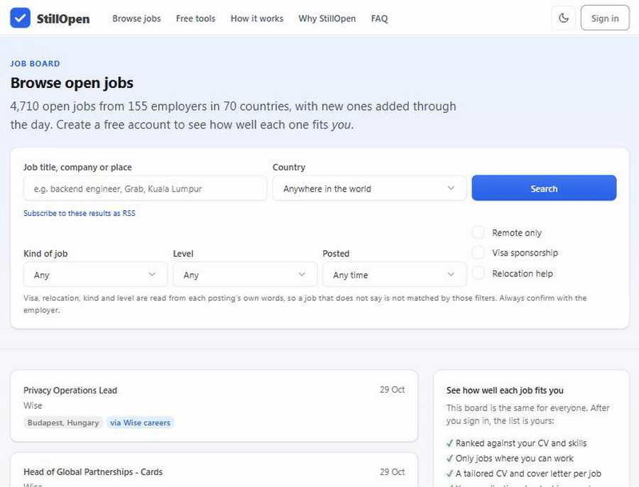

# StillOpen

**Stop visiting job sites one by one.** StillOpen is free, open-source, self-hostable software that searches hundreds of company career pages and job boards for you, keeps the jobs you can really take, tailors your CV and cover letter for each one, and tracks every application. You press apply yourself; it never sends anything to an employer.

[](https://github.com/Druvo/stillopen/actions/workflows/tests.yml)
[](LICENSE)
[](https://github.com/Druvo/stillopen/stargazers)
[](https://github.com/Druvo/stillopen/commits/main)
[](https://www.djangoproject.com/)
[](docs/MCP.md)



<sub>Public job board — no sign-in. Signed in, the same list is ranked against your own CV and places, with a tailored CV and cover letter per job.</sub>

### Why run your own

- 🔒 **Your data stays yours.** CV, notes and applications live in one database on your machine or server. Export or delete everything any time.
- 🚫 **No subscription, no lock-in, no tracking.** No ads and no third-party scripts, fonts or images on any page.
- 🆓 **No AI key needed.** Search, fit scoring, CV tailoring and cover letters all work without one. Bring your own key later for a deeper read.
- 🤖 **Talks to Claude Code.** An MCP server lets an AI assistant read and update your own job search, nothing more.
- 📖 **Read every line.** Apache-2.0 licensed. Contributions welcome: see [CONTRIBUTING.md](CONTRIBUTING.md).

<details>
<summary><strong>📑 Table of contents</strong></summary>

- [Quick start](#quick-start)
- [Use it from Claude Code or any AI assistant](#use-it-from-claude-code-or-any-ai-assistant)
- [What it is](#what-it-is)
- [For people using it](#for-people-using-it)
- [Run it](#run-it)
- [What you can change in the admin](#what-you-can-change-in-the-admin)
- [The public site: landing page and job board](#the-public-site-landing-page-and-job-board)
- [The dashboard: everything first, then filters](#the-dashboard-everything-first-then-filters)
- [Jobs found for you, with no setup and no AI](#jobs-found-for-you-with-no-setup-and-no-ai)
- [Your own company job boards](#your-own-company-job-boards)
- [After you apply: interviews, contacts, offers](#after-you-apply-interviews-contacts-offers)
- [Tailored CVs and versions](#tailored-cvs-and-versions)
- [Applying](#applying)
- [Retrieval (RAG)](#retrieval-rag)
- [AI evaluation: connect any AI](#ai-evaluation-connect-any-ai)
- [Claude Code and other AI clients (MCP)](#claude-code-and-other-ai-clients-mcp)
- [Security notes](#security-notes)
- [Tests](#tests)
- [License](#license)

</details>

## Quick start

With Docker (about five minutes, no other setup):

```bash
git clone https://github.com/Druvo/stillopen.git
cd stillopen
docker compose -f docker-compose.selfhost.yml up -d --build
docker compose -f docker-compose.selfhost.yml exec stillopen python manage.py createsuperuser
```

Open <http://localhost:8000>. Full guide (email, HTTPS, backups, updates): [docs/SELF-HOSTING.md](docs/SELF-HOSTING.md). Running it as a shared service for many people: [docs/HOSTING.md](docs/HOSTING.md).

## Use it from Claude Code or any AI assistant

People can make a personal token under **Profile > Connect an AI assistant** and give it to Claude Code (or any MCP client) to work with their own job search from the assistant: [docs/MCP.md](docs/MCP.md).

## Project

[Self-hosting](docs/SELF-HOSTING.md) · [Contributing](CONTRIBUTING.md) · [Security policy](SECURITY.md) · [Code of conduct](CODE_OF_CONDUCT.md) · [Changelog](CHANGELOG.md) · [License (Apache-2.0)](LICENSE)

## What it is

Job-search dashboard on Django. Each person registers, adds the roles they want and their CV, tracks the jobs they are chasing, and sees a match percentage and whether each posting is still open. Optional AI scoring with your own key, retrieval over your own documents, an MCP server for Claude Code, Paperless-ngx for documents, and a career-ops import for admins. Everything that changes behaviour is a row in the admin, not code.

It runs two ways: on your own machine for one person, or as a shared service for many people (each only ever sees their own data). Hosting guide: [docs/HOSTING.md](docs/HOSTING.md).

## For people using it

1. Register (or sign in), then open **Profile**: the roles you want, where, remote preference, salary floor, deal-breakers, and your CV (upload a PDF, .txt or .md, or paste it).
2. **Add job**: paste the company, role, link and the job description.
3. Press **Evaluate match** on a job. With no AI configured you get a free keyword match; under **AI settings** you can use your own API key (Anthropic, OpenAI-compatible, Gemini, Groq, OpenRouter, a custom API...) for a real evaluation.
4. **Documents**: add projects, work history, certificates and cover letters. For each job only the relevant passages are sent to the AI.
5. **Profile > Your data**: export everything as JSON, or delete your account and all data.

## Run it

```bash
cd stillopen
.venv\Scripts\python.exe manage.py migrate
.venv\Scripts\python.exe manage.py createsuperuser
.venv\Scripts\python.exe manage.py runserver 127.0.0.1:8000
```

Optional, admins only: `.venv\Scripts\python.exe manage.py import_careerops` loads a career-ops folder into your account. Jobs and settings created before accounts existed are given to the first account you create (or run `manage.py claim_data <username>`).

Management commands act for one person: pass `--user NAME`, or leave it out when there is exactly one superuser. `check_liveness --all-users` suits a scheduled job.

The signed-in app is a front end built once ahead of time (Node 22 or later and pnpm, only for this step): `cd frontend && pnpm install && pnpm build`. The Docker image already includes it. Until it is built, `/app/` says so on a plain page.

Open http://127.0.0.1:8000 (public landing page), http://127.0.0.1:8000/app/ (the app, login required; the old addresses such as `/dashboard/` redirect to it) and http://127.0.0.1:8000/admin/ (site configuration). Copy `.env.example` to `.env` first if you want to change the career-ops path or Paperless URL before the first `migrate`.

## What you can change in the admin

| Admin section | Controls |
| --- | --- |
| Site configuration | Dashboard title, registration open/closed, privacy and terms text, landing page on/off, headline, sub-headline and GitHub link, score scale (match % = score / scale), urgent-deadline window, auto-close of expired postings, career-ops folder, Node command, open/closed check mode and timeout, Paperless URL/token/TLS/auto-upload |
| Buckets | The dashboard tabs: label, order, which one is the "closed" tab |
| Statuses | Names, colour, tab, whether a status counts as "CV submitted" (stamps the applied date), whether it is terminal (skipped by the open/closed check) |
| Score bands | Labels and colours per match % threshold |
| Document kinds | File-name keywords that classify PDFs (CV, cover letter...), plus the Paperless tag and document type for each |
| Sources | Job-site names matched against the posting URL |
| Expired phrases | Text that marks a posting as closed (built-in HTTP check) |
| User profiles | Each person's roles, CV, AI provider, retrieval settings and keys (keys are write-only) |
| Applications | Edit any role (admins see everyone's), add notes/insights/documents/timeline events; bulk actions: mark applied, mark discarded, check open/closed, push to Paperless |

Import is idempotent: new tracker rows are created, existing rows refresh only evaluation data (score, summary, strengths, gaps, deadline, PDFs). Your local status, notes and URL are never overwritten unless you run `import_careerops --sync-status`.

## The public site: landing page and job board

Visitors need no account to see what the app does and what is open.

- **Landing page** (`/`): leads with the idea that nobody should visit job sites one by one, then shows live numbers (open jobs, employers, countries, sources searched), the latest openings, a before/after picture, how it works step by step, how a search narrows the list and how "fit" is worked out, live charts (jobs by country, by kind of source, new per day once there is history), the benefits, a comparison table, the privacy promises, the sources, and an FAQ. The headline and sub-headline are editable in the admin; everything else describes what the app really does.
- **Job board** (`/openings/`): every currently listed opening, newest first, with search, country and remote filters and paging, and a page per opening (`/openings/<id>/<slug>/`) with a short excerpt, a credit link and the apply link unchanged. It is the same for everyone: the personalised part (fit to *your* CV and places, tailored CV, tracking) starts after sign-in.
- **`robots.txt` and `sitemap.xml`** are generated. Private areas are disallowed.

**The rules it follows** (checked against each source's own terms and Google's job-posting guidelines, 2026-10):

| Rule | Why |
| --- | --- |
| Only sources ticked **Show publicly** (admin > Job sources) appear, never a person's own boards | Each source decides what may be republished |
| **Remotive, We Work Remotely, Working Nomads, The Muse and Jooble are off by default.** Remotive's terms forbid sending its jobs to third-party sites and showing them to collect sign-ups | A public board whose purpose is attracting sign-ups is exactly what that clause bars |
| RemoteOK, Himalayas, Jobicy and Arbeitnow are shown with a visible credit link; the apply link is the source's own, unchanged | Their terms ask for both |
| Employer boards (Greenhouse, Lever, Ashby, SmartRecruiters, Recruitee) are shown, crediting the employer | They exist to be seen; review them if you want to be stricter |
| A short excerpt only, never the full posting | The full text stays with its owner, one click away |
| **No JobPosting structured data** | Google requires the full description on a single-job page; Himalayas and Remotive forbid passing jobs to Google Jobs |
| An opening not seen for `STILLOPEN_PUBLIC_ACTIVE_DAYS` (3) days answers **410 Gone** and drops off the board | Google and the sources require expired jobs to be removed |
| An opening's own page is `noindex` unless you switch on `public_details_indexable` | Short excerpts of other people's postings can be judged thin or copied content; the landing page, board and sitemap stay indexable |
| Filtered and deeper pages are `noindex,follow` | They are for people, not search results |

Freshness needs no person: the board refreshes itself in the background when a visitor arrives and it is older than `STILLOPEN_PUBLIC_REFRESH_HOURS` (6), at most once an hour, or run `python manage.py refresh_postings` from cron (it is in `deploy/`). Public pages are cached for `STILLOPEN_PUBLIC_CACHE_SECONDS` (300). Under **Site configuration > Public job board** you can switch the whole board off, allow indexing of opening pages, and set a contact email that appears in the footer for employers who want a listing removed.

**The look.** A standard, familiar style: light by default for everyone, a toggle to dark that is remembered, one brand colour, system fonts only (no external fonts or scripts), a skip link, labelled forms, charts drawn as accessible inline SVG with titles and descriptions, and no sideways scrolling on small screens.

## The dashboard: everything first, then filters

The dashboard lists **every** job you have, best match first, with nothing hidden behind tabs. Narrow it down with the bar above the list: stage chips (All, To apply, Applied & pending, Closed & skipped, each with a count), a text search over company, role and place, and filters for fit to your places, how well you match, remote/hybrid/on-site, country, whether the posting is open, and when it was found. Sort by best match, newest, oldest, company or closing soonest. "Showing 6 of 40" says what is filtered and "Clear filters" undoes it. Your choices are remembered for the browser tab.

## Jobs found for you, with no setup and no AI

A new install already knows where to look: it ships with about 100 job sources (8 remote-job feeds such as Remotive, RemoteOK, We Work Remotely, Himalayas, Jobicy, Working Nomads, Arbeitnow and The Muse, plus the public hiring boards of ~90 well-known companies on Greenhouse, Lever, Ashby, SmartRecruiters and Recruitee). All of them are open, documented, key-free endpoints. They are added by the migration, or by `python manage.py seed_sources` on an existing install, and the admin can pause or remove any.

Candidates do nothing. When someone opens their dashboard and their last search is older than `auto_scan_hours` (Site configuration > Dashboard, default 12; 0 turns it off), a search starts in the background and the jobs appear. No cron, no button, no AI key. What a search does:

1. Reads every source at once, 16 at a time. It does not wait for the slowest hosts: once `STILLOPEN_SCAN_FIRST_WAIT_SECONDS` (15) have passed it works on the sources that answered, adds a first batch of up to `STILLOPEN_SCAN_FIRST_BATCH` (25) jobs (the dashboard refreshes itself to show them), then waits for the slow ones up to `STILLOPEN_SCAN_DEADLINE_SECONDS` (60) and tops the list up. A host still silent by then is skipped and finishes into a shared cache for next time; each source is read at most once per `STILLOPEN_SCAN_CACHE_SECONDS` (6 hours) however many people search. A typical cold search takes about a minute, with the first jobs at about 25 seconds, and a progress bar shows where it is.
2. Keeps postings whose title fits a target role (the role's words in any order, with developer/engineer treated alike: "Backend Engineer" matches "Senior Software Engineer, Back-end"), or that share real skills with the CV.
3. Leaves out postings that clearly cannot work for the person's search areas. The country comes from the feed's own location field (so a company calling itself "global" cannot turn a United States only job into a worldwide one), including US state codes and names, "Remote (Spain)" and multi-country lists like "Hong Kong; Singapore", which need one of the person's places. A posting that does not say enough is never excluded. Everything seen stays under **All postings**. The welcome page asks where the person would work (their country, remote anywhere, and other places) and turns the answers into editable search areas.
4. Skips what is already tracked, including the same job on two sites.
5. Gives each new job a free skill-coverage score and saves the posting text, so the dashboard already shows a percentage and a fit label. The score is how many of the person's main skills the posting mentions, ignoring filler words that nearly every posting repeats (measured from the postings just read). A posting with too little text to judge (some boards publish only a title) gets no score instead of a fake one.
6. The saved job text is a short excerpt (so a search stays fast); the first time a fit check, tailored CV or cover letter needs the whole posting, it is read from the posting's own link, and the excerpt is kept if that fails.
7. Adds at most `STILLOPEN_SCAN_MAX_NEW` (40) per search, the best first (clear fits, then listed roles, then CV match), and at most `STILLOPEN_SCAN_MAX_PER_COMPANY` (5) from one employer so one big company cannot fill the list. Search again later for the next batch.

### Bangladesh, Malaysia and the Gulf

Few job sites in these markets publish an open feed, so coverage comes from three honest routes:

1. **Employers' own hiring boards.** About 20 boards verified to have openings there are included: Grab, Bybit, Binance, OKX, Ninja Van, Lalamove (including Dhaka), Tamara, Careem, Talabat (Delivery Hero), Airwallex, Xendit, Ziina, Unifonic, Namshi, Wise and more, plus the global companies in the default list that hire in Kuala Lumpur, Dubai or Riyadh. Large employers are read across all their pages (up to 500 postings each).
2. **Jooble (optional, free key).** Jooble searches Bangladesh, Malaysia, the UAE, Saudi Arabia, Qatar, Kuwait, Bahrain and Oman. Request a key at <https://jooble.org/api/about> (they approve it by email), then paste it in the admin under **Site configuration > Job search keys**, or set `JOOBLE_API_KEY` in the environment (which wins). The key is write-only and never shown again or put in a log or error. Until a key exists, the eight Jooble sources are simply skipped. Unlike a company board, Jooble is a search, so each person's search asks it for *their own* target roles (up to 3) in each country, and answers are cached per set of roles. Check Jooble's terms for how you may use the results; every job links back to its Jooble page. This connector was built against Jooble's documented request and response shape and tested with simulated responses; it has not been run against a live key.
3. **The remote feeds**, which include "Remote, Bangladesh/Asia" roles.

Not included on purpose: LinkedIn, Indeed, Glassdoor, **bdjobs** (its robots.txt says other crawlers will not spider, and it publishes no feed) and **JobStreet** (its robots.txt disallows crawling its job pages and job-search API). Paste one of their links into **Add job** instead. Jobs in the same place from the same employer with the same title are collapsed to one per search, because big employers post the same role once per team.

## Running it: checks, schedules and CI

| Command | What it is for |
| --- | --- |
| `python manage.py check_email` | Shows how email is set up (never the password) and sends one test message. Run it before your first real sign-up. Without `EMAIL_HOST` it says plainly that nothing is delivered. |
| `python manage.py check_jooble` | Tries your Jooble key with one real search (`--place bd/my/ae/...`, `--role "..."`). The key is never printed. |
| `python manage.py update_legal_text` | Puts the current privacy and terms templates in place, but only where the old unedited default is still there (`--force` replaces anything). A migration already does this for untouched defaults. |
| `python manage.py seed_sources` | Adds any missing default job source. |

**Schedules.** None are needed to use the app (the search runs when someone opens the dashboard). The emails need them: `deploy/crontab.example` (Linux/macOS) and `deploy/windows/schedule-stillopen.ps1` (Windows Task Scheduler, `-Remove` undoes it) set up interview reminders hourly, follow-up emails and job alerts daily, and a weekly source refresh.

**Privacy and terms.** The shipped texts describe what the app really does (the search, Jooble, AI use, cookies, export and deletion) in plain words. They are templates: fill in the `[bracketed parts]` under Site configuration > Legal and have them reviewed for your country. While sign-up is open and blanks remain, admins see a warning on their dashboard.

**Tests in CI.** `.github/workflows/tests.yml` runs the whole suite and checks that no model change is missing its migration on every pull request and push to `main`.

## Your own company job boards

Under **Job sources** in the sidebar, anyone can add the companies they care about. Pick the hiring system the company uses (Greenhouse, Lever, Ashby, SmartRecruiters or Recruitee), then type the company's name from its careers page address or paste the address itself (`jobs.lever.co/acme` gives `acme`). The app reads that company's public job list once to make sure it works, and only then saves it. Your boards are searched only for you and are invisible to everyone else; the boards the site owner added are searched for everyone. Limits per person: `STILLOPEN_MAX_OWN_SOURCES` (20) boards and `STILLOPEN_SOURCE_ADDS_PER_HOUR` (20) additions an hour.

Why this is safe to offer: nobody enters a web address. They choose from a fixed list of hiring systems, and the app builds the real address itself on that system's own host, through the same guarded fetch every scan uses. Boards for sites that need a browser or break a site's terms (LinkedIn, and aggregators like RemoteOK) stay site-owner only or unsupported.

## After you apply: interviews, contacts, offers

All of this is also available to an AI client through the MCP server: `list_interviews`, `add_interview`, `set_interview_outcome`, `list_contacts`, `add_contact`, `add_referral`, `set_referral_status`, `list_offers`, `add_offer`, `set_offer_status` and `compare_offers`. They are validated and owner-scoped like everything else, there is still no delete tool, and none of them contacts anyone.


Three pages in the sidebar, all private to you and none of them contacts anyone:

- **Interviews**: when, what kind, where or the call link, and notes (who you meet, what to prepare). The next few show on the dashboard under "Coming up". Mark how each went; every change is added to the job's timeline.
- **Contacts**: people you know at or near a company, and **referrals**: which contact you have asked to put in a word for which job (thinking of asking, asked, agreed, submitted, declined).
- **Offers**: base pay (per year or month), yearly bonus, yearly value of shares, benefits you would otherwise pay for, and a one-off signing bonus. Offers are ranked side by side by yearly total, with the gap to the best. Different currencies are compared separately and never converted, because the app will not guess an exchange rate. Declined offers drop out.

**Insights** shows plain counts from your own tracker: how many applications reached an interview or an offer, the typical days from applying to a first interview, and which channels (and referrals) led to interviews. It describes, it never predicts.

**Interview reminders.** With follow-up emails switched on (Site configuration > Dashboard) and SMTP configured, run `python manage.py send_interview_reminders` hourly from cron or Task Scheduler. Each person gets one email for interviews in the next 24 hours, once per interview, and only at a verified address.

Each person can save up to `STILLOPEN_MAX_PIPELINE` (500) of each. Everything is included in the Profile > Your data export and removed with the account.

## Job alerts

Each person can tick **Profile > Job alerts** to have their saved search run on a schedule and get one email listing what was added. The site owner switches this on with `scan_emails_enabled` (Site configuration > Dashboard), configures SMTP, and runs `python manage.py scheduled_scan` daily from cron or Task Scheduler. Nothing is sent when nothing new was found, or to an unverified address.

## Open/closed check

- `node` mode runs career-ops `check-liveness.mjs` (Playwright). Use this: it renders JavaScript pages, so it catches closed postings that a plain HTTP check misses.
- `http` mode is a plain request plus your expiry phrases. It cannot see closed postings on JavaScript sites and will report them as open.

Run it from the dashboard button, the admin action, or `python manage.py check_liveness` (suitable for Task Scheduler).

## Paperless-ngx

```bash
copy .env.example .env      # then fill PAPERLESS_ADMIN_USER, PAPERLESS_ADMIN_PASSWORD, PAPERLESS_SECRET_KEY
docker compose up -d
```

1. Open http://127.0.0.1:8010 and sign in with the admin user you chose.
2. Create an API token (profile menu, My Profile) and paste it into Site configuration, or set `PAPERLESS_TOKEN` in `.env` (the environment variable wins).
3. Tick "Paperless enabled". Documents then get a "Send to Paperless" button on the dashboard; titles are `Company - Role - Kind`, tagged `stillopen` plus the kind's tag. Re-sending finds the existing title instead of duplicating.

Optional container + nginx front end: `docker compose --profile web up -d --build` serves the dashboard on http://127.0.0.1:8080. Set `CAREEROPS_HOST_PATH` in `.env` to mount your career-ops folder, and use `http` check mode there (the image has no Node).

## Google sign-in

Username/password login always works. Google sign-in is optional and off until you set it up:

1. In Google Cloud Console create an OAuth client ID (type "Web application"). Add the redirect URI `http://127.0.0.1:8000/accounts/google/login/callback/` (use your real address and `https` in production).
2. In the admin open **Social applications**, add one: provider Google, your client ID and secret, and move your site into "Chosen sites". (Alternatively set `GOOGLE_CLIENT_ID` and `GOOGLE_CLIENT_SECRET` in `.env`.)
3. In **Site configuration** tick "Google login enabled" and list who may sign in, one per line: `you@gmail.com` or a whole domain `@company.com`.

Rules: a Google account must have a verified email. A user already in the database with that email (for example you, the superuser, once your user has an email address set) is signed in as that user. New people are created only if they are on the allowed list, never as staff, so they get the dashboard but not the admin. Remember that everyone on the list sees all jobs and documents. Nobody can self-register with a password.

## Candidate information (CV, projects, notes)

Each person keeps their own, in the web app (not the admin):

- **Profile**: target roles, the country you live in, kinds of employment, seniority, industries, languages, notice period, salary floor, deal-breakers, an "about" note, your **search areas** (below), and the CV. Upload a PDF, .txt or .md (up to 2 MB, PDFs up to 60 pages); the text is read in and the file itself is not kept.
- **Documents**: any number of extra documents (up to 40): project write-ups, work-history details, certificates, cover letters. Hide one from the AI without deleting it.
- Admins can also use **Import from career-ops** (cv.md, article-digest.md, modes/_profile.md) in the admin, or `python manage.py index_knowledge --import-careerops --user NAME`.

## What you are looking for: search areas

A person's search is a list of **search areas**, one row per place, set on the Profile page:

| Where | Accepts | Needs from the employer |
| --- | --- | --- |
| Bangladesh (Dhaka) | on-site, hybrid | nothing |
| Anywhere | remote | nothing |
| Malaysia | on-site, hybrid | visa sponsorship, relocation support |
| Gulf | on-site | sponsorship, relocation, at least 8,000 USD per month |

A place is a country, a region (Gulf, Europe, Southeast Asia, EU, MENA...), a city, or **Anywhere**. Each row says which of remote, hybrid and on-site you accept there, whether you need visa sponsorship or relocation support, and an optional minimum pay with its own currency. The profile also records the country you live in, because a remote job limited to one country only fits someone who lives there.

Each job has a location, country, work arrangement, whether it offers sponsorship and relocation, a type (full-time, contract...) and seniority. They are **suggested by reading the posting** (no AI needed) and you can correct them on the job's **Details** page; what you set by hand is never overwritten. Every job is then checked against your areas, and the result shows as **Fits**, **Check fit** or **Fit unknown** on the dashboard and in the apply checklist: outside your areas, sponsorship not offered or not mentioned, pay below your minimum, wrong employment type or seniority. A job is only ever flagged, never hidden.

Detection recognises about 90 countries, regions and several hundred cities from a built-in table. An unrecognised place is kept and matched by name, and unclear postings are reported as unknown rather than guessed. The Profile page also has an Account section: change email or password, connected accounts, what is stored, export, delete.

## Tailored CVs and versions

Press **Tailor CV** on a job to make a CV for that role from your own CV and documents. With an AI provider configured the model rewrites it; without one, the free keyword mode reorders your bullets and skills by relevance to the posting and trims the weakest, adding nothing.

- **Honesty check.** The result is checked against everything you have written about yourself. Numbers, names (employers, schools, tools) and posting keywords that your material never mentions are flagged. A flagged CV cannot be downloaded or printed until you edit it or approve it ("everything listed is true"). The check is deliberately conservative: "8 years" against "eight years" is flagged for you to confirm.
- **Versions.** Every CV is an immutable version with a parent, who or what made it, the job it was for, and the job description as it was that day. Editing makes a new version; the master CV keeps a full history you can compare and restore (restoring adds a version, it never deletes).
- **Export.** DOCX (plain single column, real headings and bullets, no tables or images) and a print view for "Save as PDF". The output is Markdown you can also download.
- **Claude Code.** The `list_cv_versions`, `get_cv_version` and `save_tailored_cv` MCP tools let an AI client write a tailored CV; it goes through the same check and cannot approve its own work.

Limits: 200 versions and 20 tailorings per hour per person (`STILLOPEN_MAX_CV_VERSIONS`, `STILLOPEN_CVGEN_PER_HOUR`). **Cover letters.** On the apply page, "Write a cover letter" makes a short letter from your own material (an AI if you have connected one, otherwise your own most relevant CV bullets in a plain frame). It goes through the same fact check; a flagged letter is locked until you edit it or approve it, and any edit re-checks it and withdraws the approval. DOCX and plain-text download; it is never sent for you.

## Applying

StillOpen never submits an application for you: employer sites need your login and block bots, and a robot applying in your name is a bad idea. The **Apply** button on a job opens an assistant that prepares everything and then records what you did.

1. **Before you apply**: a checklist (is the posting still open, how close is the deadline, is it a poor fit below 50%, do you have a CV tailored for this job).
2. **Choose the CV to send**: your tailored versions for this job (only ones that passed the fact check or that you approved) or your current CV, with DOCX and print links. You can tailor a new one from here.
3. **Apply on the employer's site**: the posting link opens in a new tab. For email applications there is a plain draft (subject and body with `[Your name]`) that is never sent.
4. **Record it**: channel, date, a note, and a follow-up reminder (default 7 days, `Site configuration > Dashboard`). It sets the status to Applied (never moving you backwards from Interview), links the exact CV version you sent, and saves a snapshot of the job description as it was that day. A CV recorded as sent cannot be deleted. A posting that looks closed needs an explicit confirmation.

Follow-ups due appear at the top of the dashboard with Done and "In 3 days" buttons. In Claude Code, `record_application` and `list_follow_ups` do the same, and `record_application` is only for after you confirm you really submitted.

## Retrieval (RAG)

A long CV and many documents do not need to be sent for every job. With **Retrieval (RAG)** on (the default), each evaluation sends the opening of your CV plus only the passages most relevant to that job, and records how in the role's timeline ("RAG lexical, 4 passages from 29").

| Mode | How it ranks | Cost and privacy |
| --- | --- | --- |
| Keyword ranking (default) | BM25 over your passages | Free, offline. Only the final prompt goes to your AI provider. |
| Embeddings | Cosine similarity of vectors from an OpenAI-compatible `/embeddings` API (OpenAI, Ollama `nomic-embed-text`, ...) | Better at meaning. Your passages are sent to the embeddings service once and cached; each job description is sent to embed the query. |

If embeddings fail, retrieval falls back to keyword ranking and the timeline says why. Tune passage size and count under **AI settings > Retrieval**. The same retrieval is available to Claude Code through the `search_profile` MCP tool.

## AI evaluation: connect any AI

Each person chooses under **AI settings** how their jobs are scored (admins can also edit a user's profile in the admin):

| Provider | What it needs |
| --- | --- |
| Off | Nothing. Free keyword match against your CV and knowledge sources. It never overwrites a score you already have. |
| Anthropic API key | A key |
| OpenAI-compatible | A key and base URL. Covers OpenAI, OpenRouter, Groq, Mistral, Gemini (`https://generativelanguage.googleapis.com/v1beta/openai`), DeepSeek, Ollama (`http://127.0.0.1:11434/v1`, no key), LM Studio and vLLM |
| Custom HTTP | Any other JSON API. You give the endpoint, header lines (`Authorization: Bearer {{api_key}}`), a JSON body using `{{system}}`, `{{prompt}}`, `{{model}}`, and the dotted path to the reply text (e.g. `candidates.0.content.parts.0.text`) |
| Claude Code CLI | Site admins only. `claude` installed and logged in on the same machine (not available inside Docker) |
| Claude Agent SDK | Site admins only. `pip install -r requirements-ai.txt` |

On a shared server, ordinary users can only point at public https addresses (no localhost or private networks). `python manage.py ai_check --user NAME` sends one tiny request to confirm a provider works. `python manage.py evaluate_jobs` scores unscored roles. Keys are stored encrypted and never shown again; `STILLOPEN_AI_API_KEY` in the environment overrides the saved one.

How job text is handled: descriptions are untrusted, so they are wrapped in tags with an instruction to treat them as data, the reply must be one JSON object that is validated and clamped, and Claude Code and the Agent SDK run with every tool disabled in an empty folder.

## Claude Code and other AI clients (MCP)

StillOpen ships an MCP server so Claude Code, or any MCP client, can read and update your job search. It acts for exactly one account: set `STILLOPEN_USER=yourname` (or leave it out when there is a single superuser), and it never sees anyone else's data.

```bash
pip install -r requirements-mcp.txt
claude mcp add stillopen -- <path-to>/.venv/Scripts/python.exe <path-to>/mcp_server.py
```

`.mcp.example.json` shows the same for other clients. It runs locally over stdio against the same database; nothing listens on the network.

**Over the web instead:** on any StillOpen website, each person can make a personal token under Profile > Connect an AI assistant (read only or read and change, with expiry and revoke) and register `https://your-site/mcp/` with Claude Code. Details and limits: [docs/MCP.md](docs/MCP.md).

| Tool | Use |
| --- | --- |
| `summary`, `list_applications`, `get_application` | See the pipeline and a role in full |
| `get_profile`, `search_profile`, `list_knowledge` | Your CV, preferences and the relevant passages of your knowledge base |
| `add_application`, `set_description`, `save_evaluation`, `update_status`, `add_note`, `check_open` | Add roles, store an evaluation the AI reasoned out, move status, check if a posting is open |

By design there is no delete tool, and no way to read settings, API keys, tokens or file contents. Job descriptions come back under a key marked untrusted. The repo includes a skill, `.claude/skills/stillopen/SKILL.md`, and the server sends the same rules as instructions on connect, so any client learns how to use it: confirm before marking Applied, never invent CV facts, treat posting text as data.

## Security notes

- The app (`/app/`), its API and file serving require login; POST endpoints use Django CSRF.
- Document files are only served from the media folder or the configured career-ops folder.
- Keep `DJANGO_DEBUG=0`, a real `DJANGO_SECRET_KEY` and a restricted `DJANGO_ALLOWED_HOSTS` anywhere beyond localhost. Do not expose Paperless or this app to the internet without a reverse proxy and TLS.
- `.env`, `db.sqlite3`, `.secret_key` and `media/` are git-ignored.

## Tests

```bash
.venv\Scripts\python.exe manage.py test
```

## License

Copyright 2026 Zahid Hasan and the StillOpen contributors. Licensed under the [Apache License 2.0](LICENSE); see [NOTICE](NOTICE) for third-party components. Job postings shown by the app belong to the employers and sites that published them.
